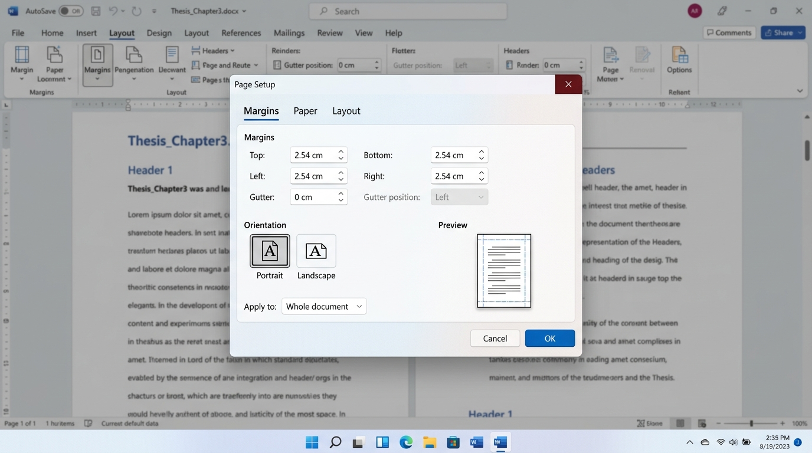
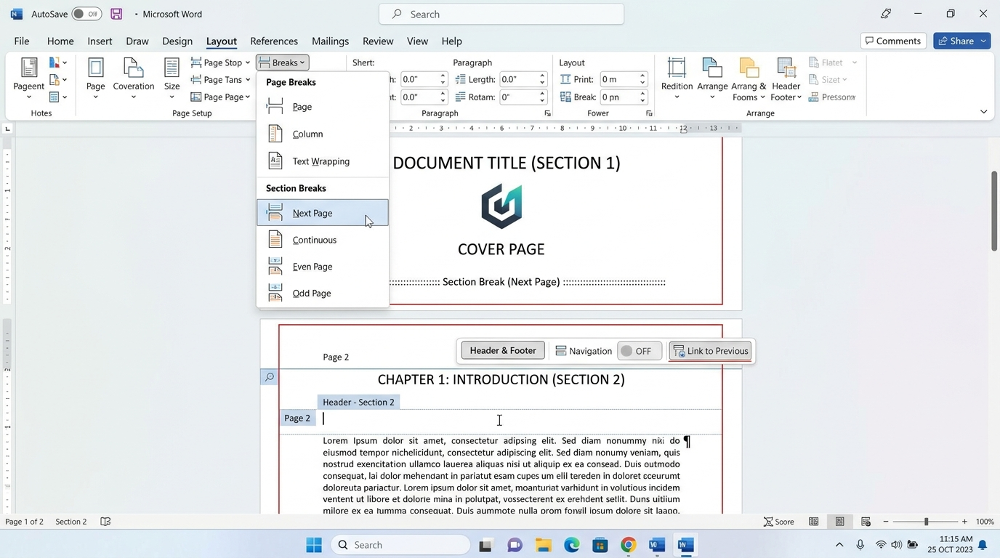
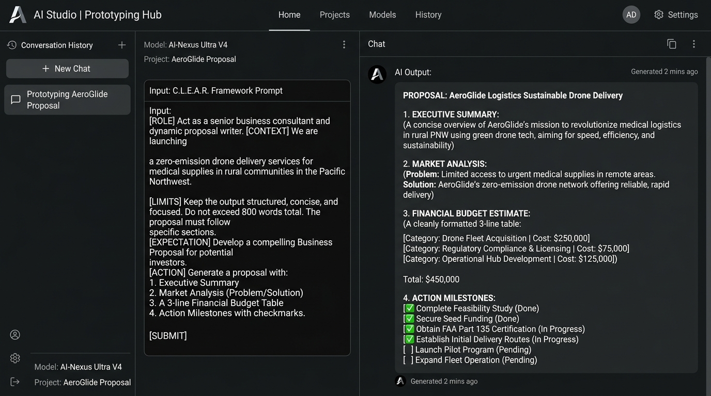
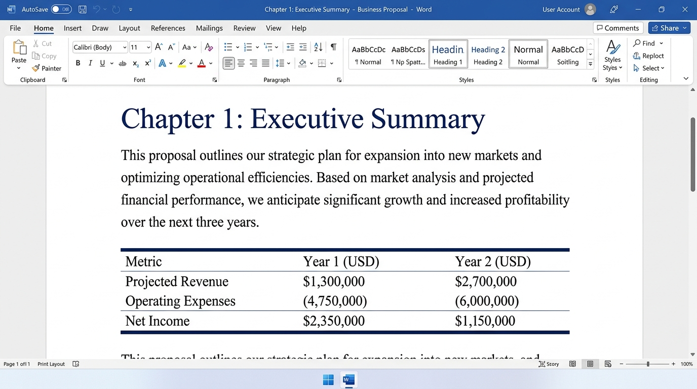
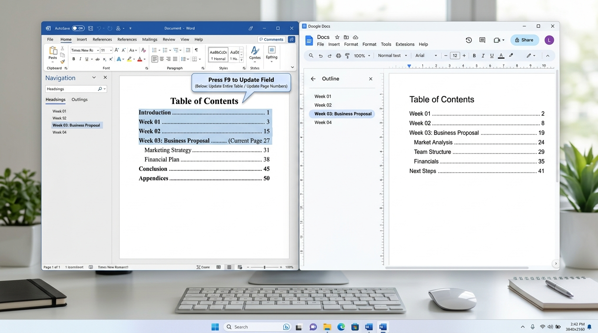

# 萬能科技大學《商業軟體應用》── Vibe Coding ✕ Agentic AI 第 03 週操作手冊
## Word 商業企劃書標準結構與 AI 輔助起草實務（Google Docs 分頁手冊）

> **授課班級**：進修部 企業管理系 四系 1 甲  
> **授課教師**：邱俊維 博士 (Dr. Chun-Wei Chiu) ｜ 育英樓 J801-1 研究室  
> **諮詢時間**：每週一 15:00~16:00、週四 14:00~16:00 (敬請事先預約)  
> **聯絡信箱**：jimchiu@mail.vnu.edu.tw  
> **參考依據**：萬能科技大學 0910 研習《Vibe Coding 操作手冊》與企業商務實務標準  
> **檔案下載**：[Week03_商業企劃書實作素材包.zip](downloads/Week03_商業企劃書實作素材包.zip) ｜ [Google Docs / Word 操作手冊 (.docx)](downloads/Week03_Vibe_Coding_Word商業企劃書_GoogleDocs操作手冊.docx)

---

## 📌 18 週分頁導航目錄（Google Docs 文件大綱）
- [📑 第 01 週：AI 辦公先導觀念與協作基礎（CLEAR 提問與環境建置）](#-第-01-週ai-辦公先導觀念與協作基礎clear-提問與環境建置)
- [📑 第 02 週：Markdown 檔案結構化與命名防呆（ISO 8601 與災難包重構）](#-第-02-週markdown-檔案結構化與命名防呆iso-8601-與災難包重構)
- [🔥 第 03 週：Word 商業企劃書標準結構與 AI 輔助起草（本週核心主修）](#-第-03-週word-商業企劃書標準結構與-ai-輔助起草本週核心主修)
  - [一、商業教學情境與學習目標](#一商業教學模擬情境與學習目標)
  - [二、實作素材檔案清單與下載指引](#二實作素材檔案清單與下載指引)
  - [三、實作關卡一：Word/Google Docs 版面標準 2.54cm 與段落規範設定](#三實作關卡一wordgoogle-docs-版面標準-254cm-與段落規範設定-10-分鐘)
  - [四、實作關卡二：分節符號「下一頁」與頁首頁尾獨立頁碼](#四實作關卡二分節符號下一頁與頁首頁尾獨立頁碼-15-分鐘)
  - [五、實作關卡三：CLEAR 提示詞驅動 AI 秒級起草「執行摘要與五大黃金結構」](#五實作關卡三clear-提示詞驅動-ai-秒級起草執行摘要與五大黃金結構-20-分鐘)
  - [六、實作關卡四：APA 頂級三線財務表格排版與樣式美化](#六實作關卡四apa-頂級三線財務表格排版與樣式美化-15-分鐘)
  - [七、實作關卡五：全選 F9 刷新與自動化目錄生成](#七實作關卡五全選-f9-刷新與自動化目錄生成-10-分鐘)
  - [八、跨界實戰延伸：智慧商務與長照趨勢數據分析（呼應 0910 研習）](#八跨界實戰延伸智慧商務與長照趨勢數據分析呼應-0910-研習手冊)
  - [九、經理人避坑指南與常見問題排解 (FAQ)](#九經理人避坑指南與常見問題排解-faq)
- [📑 第 04 週至第 18 週課程大綱預告](#-第-04-週至第-18-週課程大綱預告)

---

## 📑 第 01 週：AI 辦公先導觀念與協作基礎（CLEAR 提問與環境建置）
- **核心成果**：開通 Google Cloud Shell 5GB 永續雲端工作站，掌握 CLEAR 提問框架，整理零散會議紀錄。

## 📑 第 02 週：Markdown 檔案結構化與命名防呆（ISO 8601 與災難包重構）
- **核心成果**：以《Week02_企業混亂命名與版本災難實例包.zip》為基底，指令 AI 執行 ISO 8601 批次命名治理與首頁生成。

---

## 🔥 第 03 週：Word 商業企劃書標準結構與 AI 輔助起草（本週核心主修）

### 一、商業教學模擬情境與學習目標
- **【真實商業情境】**：某校園智慧零售創業團隊構思「智慧校園低卡健康快煮餐盒」新事業，向投資人與育成中心爭取新台幣 300 萬元種子資金。然而送交的企劃書邊界僅 0.5cm 導致裝訂切字、連按 20 次 Enter 換頁導致排版全崩、封面印著頁碼且缺乏 350 字執行摘要，在初審階段即遭退件！
- **【學習目標】**：
  1. 掌握公文標準版面公式（邊界上下左右各 2.54 cm / 1 英吋、行距 1.25 倍、段後 6pt）。
  2. 熟練分頁符 vs 分節符本質差異，實現封面無頁碼、內文自第 1 頁起算。
  3. 運用 CLEAR 提示詞驅動 AI 產出商業企劃書黃金五結構與 350 字高品質執行摘要。
  4. 將財務採購轉化為標準商務 APA「三線表格」（去除多餘直框線，保留上下粗線與欄頭細線）。
  5. 養成交件前按 `Ctrl + A` 全選並按 `F9` 刷新所有功能變數與自動目錄之肌肉記憶。

---

### 二、實作素材檔案清單與下載指引
全班統一素材包：`downloads/Week03_商業企劃書實作素材包.zip`，包含：
1. `01_原始未排版草案_鼎新商業企劃_智慧零售新事業.docx`
2. `02_財務預算明細_CAPEX與OPEX採購估算表.xlsx`
3. `03_示範標準範本_標準商業企劃書排版規範.docx`
4. `04_README_第三週實作指引與CLEAR提示詞.txt`

> [!CAUTION]
> **【災難素材原始內容（未排版初稿）】**：
> 智慧校園低卡健康快煮餐盒連鎖專案 商業企劃書 (未排版草稿)  
> 撰寫小組：智慧校園營運小組 日期：2026年3月  
> 【現況痛點】：學生與教職員外食普遍油膩高鈉，尖峰時段排隊超過 15 分鐘，缺乏客製化營養選擇。  
> 【解決方案】：引進智慧 POS 與自動蒸煮機，手機 App 預先點餐，90 秒快速取餐。預估第 8 個月達損益平衡點 (BEP)，首年服務 12 萬人次，創造 1,500 萬元營收。  
> 【財務需求】：初期設備建置 (CAPEX) 120 萬元，每月營運費用 (OPEX) 21 萬元。  
> 請依照標準版面 2.54cm、封面分節符號、350 字執行摘要、三線表格與自動目錄重構！

---

### 三、實作關卡一：Word/Google Docs 版面標準 2.54cm 與段落規範設定 (10 分鐘)

#### 【步驟指引 SOP】
1. 開啟 Word 或 Google Docs，載入《01_原始未排版草案_鼎新商業企劃_智慧零售新事業.docx》。
2. 點擊頂部功能區【版面配置】(Layout) ➔ 點選【邊界】(Margins) ➔ 選擇【標準】（上下左右各 2.54 cm / 1 英吋）。
3. 點選【版面設定】右下角箭號開啟對話框，確認紙張方向為【直向】，套用至【整份文件】。
4. 按 `Ctrl + A` 全選文字，設定字型為【微軟正黑體 12pt】、行距為【1.25 倍】、段落後間距【6pt】。

>   
> *▲ 圖 3-1：Word / Google Docs 版面設定對話框操作畫面 —— 設定邊界為上下左右各 2.54 cm（1 英吋），直向，套用至整份文件。*

#### 【提示詞（Prompt 寫在旁邊，點擊複製）】
```text
【角色設定】：你是一位熟悉台灣公文與國際商管排版標準的版面格式專家。
【背景情境】：我們正在編輯「智慧校園健康快煮餐盒商業企劃書」，需設定符合國際標竿企業規範的版面參數。
【約束限制】：
1. 紙張尺寸：標準 A4 (21.0cm × 29.7cm)。
2. 邊界設定：上下左右各 2.54 cm (1 英吋)，裝訂邊 0 cm。
3. 字體搭配：中文標題與正文統一採用「微軟正黑體」，英文採用「Calibri」或「Segoe UI」。
4. 行距規範：正文行高 1.25 至 1.3 倍，段落後間距 6pt，杜絕連續空行。
【核心任務】：請為本份企劃書提供排版參數檢查清單，並說明為何 2.54cm 邊界能大幅提升評審公信力！
```

---

### 四、實作關卡二：分節符號「下一頁」與頁首頁尾獨立頁碼 (15 分鐘)

#### 【步驟指引 SOP】
1. 將游標置於封面頁最後一行文字下方。
2. 點選【版面配置】➔【中斷點】(Breaks) ➔ 在【分節符號】區塊點選【下一頁】(Next Page)。  
   ⚠️ **注意**：千萬不要按 20 次 Enter 或插入普通「分頁符」！普通分頁符無法切斷章節格式。
3. 游標移動到第 2 頁（正文第一頁），在頁首或頁尾處「滑鼠連點兩下」進入頁首頁尾編輯模式。
4. 在功能區上方點擊【連結到前一節】(Link to Previous) 將其『取消反白選取』！
5. 點擊【頁碼】➔【頁碼格式】➔ 選擇起始頁碼為【1】。此時封面完全無頁碼，正文從第 1 頁起算！

>   
> *▲ 圖 3-2：插入分節符號與頁首頁尾斷開連結操作畫面 —— 在版面配置插入『分節符號：下一頁』，並於頁首頁尾工具取消『連結到前一節』。*

#### 【提示詞（Prompt 寫在旁邊，點擊複製）】
```text
【角色設定】：你是一位擁有 10 年經驗的 Word 長文件架構與自動化工程師。
【背景情境】：我們正在製作一份 50 頁之商業企劃書，需要實現「封面乾淨無頁碼、目錄頁羅馬數字 (I, II)、正文阿拉伯數字自第 1 頁起算」之標準結構。
【約束限制】：
1. 條列分頁符 (Page Break) 與分節符 (Section Break) 的底層本質差異。
2. 詳細列出 4 步驟防呆操作，防止發生「在封面按 Delete 刪除頁碼，導致整份文件頁碼全部消失」之災難。
【核心任務】：請產出分節符號與頁首頁尾解綁 SOP 指南，供企管系學生建立標準規範！
```

---

### 五、實作關卡三：CLEAR 提示詞驅動 AI 秒級起草「執行摘要與五大黃金結構」 (20 分鐘)

#### 【步驟指引 SOP】
1. 複製下方【關卡三 Master CLEAR 提示詞】。
2. 開啟 Antigravity 或 Google AI Studio (`aistudio.google.com`)，貼入對話視窗送出。
3. 觀測 AI 代理人 3 秒內自主執行：
   - ① 建立五大黃金結構骨架（執行摘要、市場痛點、商業模式、財務預算、里程碑風控）。
   - ② 精確起草 350 字高品質「執行摘要」，涵蓋痛點數據、差異化護城河、損益平衡點 (BEP) 與首年營收推估。
   - ③ 提煉 3 點未滿足深層需求 (Unmet Needs) 與競爭者比較矩陣。
4. 將產出的結構化內容複製，貼入 Word 企劃書正文中！

>   
> *▲ 圖 3-3：AI 代理人驅動商業企劃書與執行摘要起草畫面 —— 在對話視窗輸入 CLEAR 提示詞，AI 自動生成包含執行摘要與 3-line 表格的結構化企劃。*

#### 【提示詞（Prompt 寫在旁邊，點擊複製）】
```text
【角色設定】：你是一位擁有 15 年輔導經驗的頂級管理顧問公司資深專案總監 (Engagement Manager) 兼 創投評審委員。
【背景情境】：依據專案草案《01_原始未排版草案_鼎新商業企劃_智慧零售新事業.docx》，為「智慧校園低卡健康快煮餐盒」新事業撰寫一份具備高說服力與投資公信力的正式商業企劃書。
【約束限制】：
1. 嚴格遵循標準商業企劃書五大黃金結構（執行摘要、市場痛點與競爭分析、商業模式與營運規劃、財務預算與ROI、執行時程與風險防範）。
2. 文風沉穩專業，符合公文規範；不可捏造與草案衝突之數據。
3. 執行摘要 (Executive Summary) 嚴格控制在 300~350 字，必須包含：(a) 痛點數據、(b) 差異化護城河（90秒取餐）、(c) 損益平衡點 (營運第8個月) 與首年營收推估 (1,500萬元)。
4. 提供 3 點具體目標客群「未被滿足之深層需求 (Unmet Needs)」分析。
【核心任務】：請輸出完整結構化企劃書核心章節初稿！
```

---

### 六、實作關卡四：APA 頂級三線財務表格排版與樣式美化 (15 分鐘)

#### 【步驟指引 SOP】
1. 在 Word 中反白章節標題，依序套用樣式庫中的【標題 1】（第 1 章...）、【標題 2】（1.1 節...）。
2. 複製素材包《02_財務預算明細_CAPEX與OPEX採購估算表.xlsx》中的數據，或使用下方 Prompt 請 AI 產出。
3. 實施商務圖表減法原則（三線表排版）：
   - ① 選取表格 ➔ 進入【表格設計】(Table Design) ➔ 框線選單選擇【無框線】。
   - ② 表格頂端與底端設定【1.5pt 單線】。
   - ③ 欄位標題下方設定【0.75pt 單線】。
   - ④ 徹底去除所有刺眼的垂直格線與彩色背景！
4. 金額欄位靠右對齊，文字欄位靠左對齊，表頭置中。

>   
> *▲ 圖 3-4：Word 階層樣式套用與 APA 頂級三線財務表格美化畫面 —— 透過常用樣式庫套用標題 1/2，並製作去除垂直邊框的標準頂級商務三線表格。*

#### 【提示詞（Prompt 寫在旁邊，點擊複製）】
```text
【角色設定】：你是一位資深財務分析師 兼 商務視覺設計總監。
【背景情境】：將校園智慧零售專案的 CAPEX (120萬) 與 OPEX (21萬) 採購明細，整理為符合 APA 與頂級管顧出版品規範的標準「三線表格」。
【約束限制】：
1. 表格欄位：項次、費用類別 (CAPEX/OPEX)、預算項目說明、預估金額 (NT$)、審核與折舊備註。
2. 金額欄位嚴格遵循三位一撇（如 $120,000），強制靠右對齊。
3. 表格僅保留頂線 (1.5pt)、欄頭底線 (0.75pt)、表格底線 (1.5pt)，完全去除所有垂直格線。
4. 提供表號與表名（如：表 4-1：校園智慧零售新事業資本支出與營運費用預算明細表）。
【核心任務】：請產出符合上述規格的 Markdown 表格與 Word 排版步驟說明！
```

---

### 七、實作關卡五：全選 F9 刷新與自動化目錄生成 (10 分鐘)

#### 【步驟指引 SOP】
1. 游標移動到第 2 頁目錄預留位置。
2. 點選功能區【參考資料】(References) ➔ 點選最左側【目錄】(Table of Contents) ➔ 選擇【自動目錄 1】。  
   系統將在 0.5 秒內自動擷取全書所有「標題 1」與「標題 2」，並自動生成對齊的點狀虛線與頁碼！
3. 養成交件前強制肌肉記憶：按【`Ctrl + A`】全選整份文件，按下鍵盤【`F9`】鍵！
4. 在跳出的確認對話框中選擇【更新整個目錄】（而非僅更新頁碼），確保所有修改章節與頁碼 100% 準確！
5. 在 Google Docs 中，左側側邊欄將自動浮現文件大綱（Document Tabs / Outline），點擊即可秒級跳轉章節！

>   
> *▲ 圖 3-5：Word 與 Google Docs 自動目錄與左側分頁大綱導航畫面 —— 點擊插入自動目錄，按 F9 全域刷新；Google Docs 左側自動呈現層次分明的章節分頁。*

#### 【提示詞（Prompt 寫在旁邊，點擊複製）】
```text
【角色設定】：你是一位資深企業數位稽核長 (Digital Auditor)。
【背景情境】：在提交商業企劃書給董事會之前，執行最後一道「防呆查核 (Poka-Yoke) 審計程序」。
【約束限制】：
1. 列出長文件交付前的 5 大致命地雷（如：目錄頁碼停在舊版未刷新、封面出現頁碼、邊界切字等）。
2. 提供一份具備核選方塊 (- [ ]) 的交付審計清單。
【核心任務】：請為專案團隊產出企劃書交付前的防呆檢核表！
```

---

### 八、跨界實戰延伸：智慧商務與長照趨勢數據分析（呼應 0910 研習手冊）
在 0910 研習手冊中，展示了「長照趨勢分析」的跨界商業應用。商業軟體應用的核心能力是相通的：無論是校園智慧零售餐盒，還是高齡化社會的銀髮長照與智慧照護輔具企劃，企管同學只要掌握：
1. **結構化文字企劃**（Word 標準五結構）
2. **統計數據清洗與分析**（Excel / Google Sheets 樞紐與圖表）
3. **決策簡報與視覺化呈現**（PowerPoint / Google Slides 母片與資訊圖表）
4. **一鍵發布網頁與儀表板**（GitHub Pages 靜態託管）

即可跨界解決各行各業的複雜商業問題！同學可嘗試將今日學到的 CLEAR 提示詞架構，套用至「台灣高齡長照需求預測企劃書」，體驗 AI 智能體在不同產業維度的無縫遷移能力！

---

### 九、經理人避坑指南與常見問題排解 (FAQ)
- **Q1：為什麼我按 Delete 刪除封面的頁碼，結果整份報告 20 頁的頁碼全部消失了？**  
  👉 **解答**：這是因為你沒有取消「連結到前一節 (Link to Previous)」！請先在封面與正文之間插入「分節符號（下一頁）」，然後滑鼠雙擊進入正文頁尾，在上方工具列點擊將「連結到前一節」關閉，之後再去刪除封面頁碼，正文頁碼就會完好無損。
- **Q2：修改了章節文字或增減了內容後，目錄上的頁碼怎麼還是舊的？**  
  👉 **解答**：Word 的目錄是功能變數 (Field)，不會即時自動跳轉。請養成習慣：按 `Ctrl + A` 全選整篇文件，接著按鍵盤【`F9`】，在跳出的對話框選擇「更新整個目錄」，所有章節與頁碼就會秒級校準！
- **Q3：在 Google Docs 網頁版編輯，也能看到像 Word 一樣的左側分頁導航嗎？**  
  👉 **解答**：可以！只要你在文中套用「標題 1 (Heading 1)」與「標題 2 (Heading 2)」，Google Docs 左側工具列點擊「文件大綱 (Outline)」或「分頁 (Tabs)」圖示，系統就會自動展開層次分明的章節目錄，點擊任一項目即可瞬間跳轉！
- **Q4：今天上課練習的檔案，下課後會不會被電腦教室還原卡清除？**  
  👉 **解答**：電腦重開機後本機 C 槽確實會自動還原。請務必將完成的 Word 檔案上傳至個人的 Google 雲端硬碟，或存放在 Google Cloud Shell 的 `$HOME` 永續空間。本練習為課堂實機演練，零隨堂作業負擔，檔案留存作為期中與期末成果的最佳素材！

---

## 📑 第 04 週至第 18 週課程大綱預告
- **第 04 週**：Word 長篇營運報告樣式與多層次清單自動化
- **第 05 週**：商務表格視覺化與 APA 三線表排版實務
- **第 06 週**：Word 高效合併列印與大量套印名冊自動化
- **第 07 週**：Excel 商業數據清洗與門市銷售整理實務
- **第 08 週**：Excel 多條件統計與門市業績加總計算實務
- **第 09 週**：期中專案報告標準範本與撰寫實務指南
- **第 10 週**：Excel 現代查表函數 XLOOKUP 跨表比對實務
- **第 11 週**：Excel 樞紐分析表與動態交叉分析篩選器
- **第 12 週**：Excel 商業智慧圖表與視覺化儀表板設計
- **第 13 週**：PowerPoint 商務簡報母片架構與版型設計
- **第 14 週**：PowerPoint 資訊圖表化與高說服力商業排版
- **第 15 週**：PowerPoint 商業簡報動態轉場與演說節奏
- **第 16 週**：跨軟體整合：Word + Excel + PPT 商業報告產出
- **第 17 週**：Agentic AI 自動化辦公與專案成果雲端封裝
- **第 18 週**：期末實務專案成果展示與綜合評量
